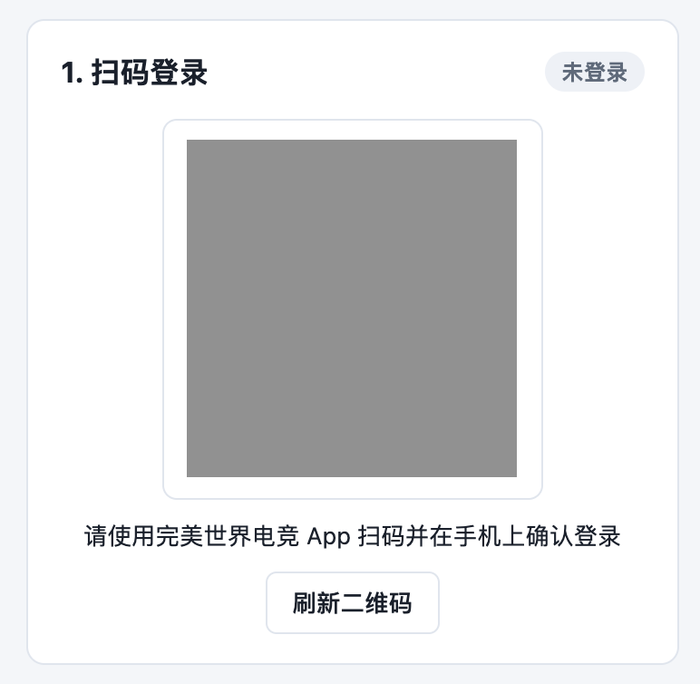
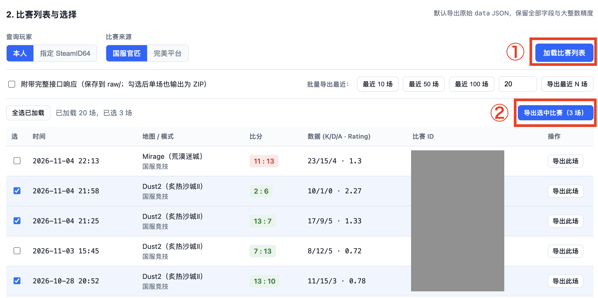
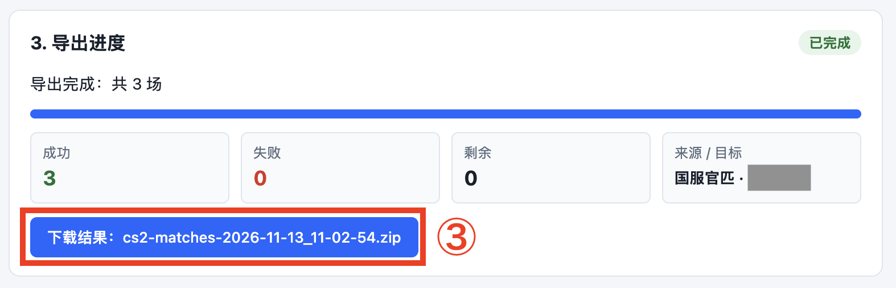

# CS2 比赛数据下载器

本地运行的轻量工具：用**完美世界电竞 App** 扫码登录，按本人或目标玩家的 SteamID64 读取**国服官匹**和**完美平台**战绩，原样导出原始比赛 JSON 或批量 ZIP 压缩包。

- **免配置运行**：Releases 提供自带 Node 运行环境的 macOS / Windows 压缩包，解压双击即可使用。
- **数据原样保留**：完整保存接口返回的比赛 `data` 与大整数精度，不做裁剪或改写。
- **仅限本机安全运行**：服务只监听 `127.0.0.1`，登录凭证仅保留在内存中，不落盘、不上传任何第三方服务器。

---

## 界面预览与操作流程

### 1. 扫码登录

打开工具后，使用完美世界电竞 App 扫描二维码并在手机上确认登录：



### 2. 加载与选择比赛

① 选择查询「本人」或「指定 SteamID64」，切换「国服官匹」或「完美平台」后点击 **「加载比赛列表」**；勾选单场或多场（也可直接使用「最近 10 / 50 / 100 / N 场」），然后点击 ② **「导出选中比赛」**：



### 3. 下载结果

导出完成后点击 ③ **「下载结果」** 即可保存单个 `.json` 文件或 `.zip` 压缩包；若部分场次失败，仍可下载已完成的结果并单独重试失败项：



---

## 快速使用（无需安装开发环境）

1. 打开本仓库右侧的 **Releases** 页面，下载对应系统的最新压缩包并解压：
   - **Windows (x64)**：下载 `...-win32-x64.zip`
   - **macOS (Apple Silicon)**：下载 `...-darwin-arm64.zip`
2. 启动工具：
   - **Windows**：双击 `启动下载器.bat`，等待自动打开浏览器页面。
   - **macOS**：双击 `启动下载器.command`，等待自动打开浏览器页面。
     > 若 macOS 提示“无法验证开发者”，请**右键点击** `启动下载器.command` → 选择 **「打开」**。
3. **退出方式**：使用完成后请点击页面右上角 **「退出工具」**，程序会清空内存登录状态与本机临时文件并自动关闭（仅关闭浏览器标签页不会退出后台程序）。

---

## 导出文件说明

### 1. 数据无损约定

- 默认导出的单场 JSON 取自比赛详情接口响应中的完整 `data` 对象（不含外层 `statusCode` 等包装信息）。
- 完整保留所有字段、嵌套结构、全部参与者信息、未知字段、原始数值与顺序；不重算 Rating、不补零、不调整队伍、不注入工具自定义字段。
- SteamID 及超长整数均在解析与序列化阶段保持原始精度，不会因 JavaScript 普通数字精度上限（`2^53 - 1`）而失真。

### 2. 文件组织结构

- **单场导出（未勾选“附带完整接口响应”）**：直接下载单个 JSON 文件，命名格式为 `<来源>-<比赛ID>.json`（例如 `official-LOCAL-504bca7fdbdc7102.json`）。
- **批量导出，或勾选“附带完整接口响应”的单场导出**：下载 `cs2-matches-<导出时间>.zip`，结构如下：

```text
cs2-matches-2026-11-13_10-32-52.zip
├── manifest.json                         # 批次清单：来源、目标玩家、数量统计、成功与失败列表
├── matches/
│   ├── official-LOCAL-xxx.json           # 无损提取的完整比赛 data 对象
│   └── perfectworld-PVP-xxx.json
└── raw/                                  # 仅勾选“附带完整接口响应”时生成
    ├── list/page-001.json                # 列表接口原始响应正文（未重新序列化）
    └── matches/official-LOCAL-xxx.json   # 详情接口原始响应正文（未重新序列化）
```

> 提示：可查询的历史深度与他人战绩可见性以完美电竞接口实际返回和账号权限为准；若接口实际场次少于请求的 N 场，会按实际数量导出并在清单中如实记录。

---

## 隐私与安全边界

- 工具不收集、不保存账号密码。
- 登录凭证（token）、二维码访问参数与 Cookie 仅存放在本机进程内存中，**不会写入日志、配置文件、`manifest.json`、`raw/` 或导出文件**。
- 本地后端仅绑定 `127.0.0.1`，并校验请求 `Host`、`Origin`、`Sec-Fetch-Site` 与客户端请求头，防止其他网页跨域调用。
- 关闭会话（退出登录 / 退出工具）后立即清除内存状态及临时目录；第一版不提供跨重启登录态保留。

---

## 本地开发与打包

环境要求：Node.js `>= 20.11.0`（推荐 Node 22 LTS）。

```sh
# 安装依赖
npm install

# 开发模式（同时启动后端与 Vite 前端热更新）
npm run dev

# 类型检查与自动化测试
npm run typecheck
npm test

# 构建生产产物（dist/ui 与 dist/server）
npm run build

# 启动已构建的本地服务并自动打开浏览器
npm run start
```

### 目录结构

```text
├── src/
│   ├── ui/                      # React + 普通 CSS 单页界面
│   ├── server.ts                # Express 本地服务与本机请求保护
│   ├── provider/perfectworld.ts # 完美电竞扫码、列表与详情接口封装
│   ├── json-lossless.ts         # 严格 UTF-8 与无损大整数 JSON 处理
│   ├── jobs.ts                  # 分页去重、限速重试、取消与过期续传
│   └── export.ts                # 单场 JSON / 批量 ZIP 与清单生成
├── scripts/
│   ├── dev.mjs                  # 本地联动开发启动脚本
│   └── package-release.mjs      # 生成含 Node 运行时与启动器的发布目录
├── tests/
│   ├── fixtures/                # 脱敏/模拟样本
│   ├── json-lossless.test.ts    # 大整数与异常 JSON 校验测试
│   └── downloader.test.ts       # 登录、导出、恢复与本地防护测试
└── .github/workflows/
    └── release.yml              # 推送 v* 标签时自动构建双平台 Release
```

### 自动发布（GitHub Actions）

打上 `v` 开头的版本标签并推送到 GitHub 后，[release.yml](.github/workflows/release.yml) 会分别在 macOS（`darwin-arm64`）与 Windows（`win32-x64`）云端环境完成检查、打包并附带 Node 22 LTS 运行时发布到 **Releases** 页面。
